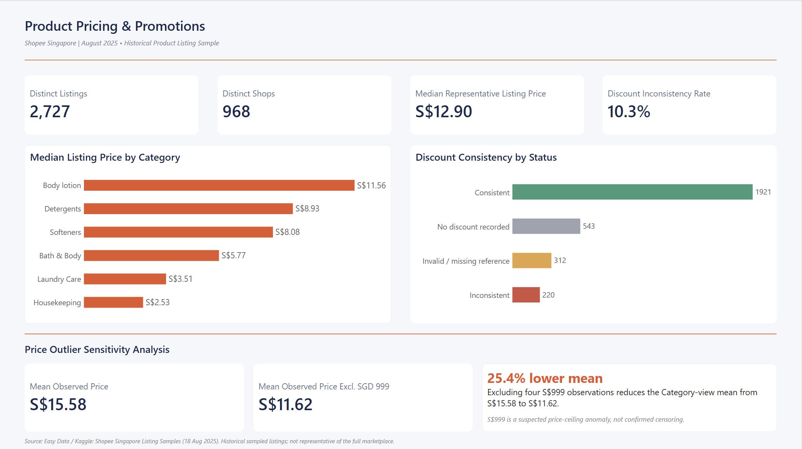

# Singapore E-commerce Marketplace & Pricing Analytics (Shopee)

A graduate Data Analyst portfolio project: an end-to-end pipeline — acquisition,
cleaning, SQL business analysis, and a two-page Power BI dashboard — over a curated
sample of Shopee Singapore product listings.

## Project overview and objectives

This project asks a narrow, concrete set of descriptive questions about one sampled
snapshot of Shopee Singapore listings, rather than making broad marketplace claims:

- How are listing prices distributed within and across a small set of sampled product
  categories, and how sensitive are those figures to a suspected price-recording
  anomaly?
- How reliable is the recorded "discount" field compared to what the listed prices
  themselves imply?
- What does assortment and pricing look like across a handful of sampled seller storefronts?
- How are recorded product ratings distributed, and how does sponsored placement show up
  in sampled keyword search results?

Every answer below is scoped explicitly to the sample described next — this project does
not claim to describe the Singapore e-commerce market as a whole, and it is **not
endorsed by or affiliated with Shopee**.

## Data source and collection date

Kaggle dataset: [`johnphamed/shopee-singapore-listing-samples-august-2025`](https://www.kaggle.com/datasets/johnphamed/shopee-singapore-listing-samples-august-2025),
published by Easy Data. Original publisher documentation:
[github.com/JohnPham-easydata/Shopee-Dataset](https://github.com/JohnPham-easydata/Shopee-Dataset).

Three Excel workbooks capture **Category**, **Keyword**, and **Store** collection views
of Shopee Singapore listings, denominated in SGD, sampled on **18 August 2025**. Each
view's own crawl burst is brief (~4 minutes), but the three views' bursts occur at
different times of day — see `docs/STAGE1_DATASET_REVIEW.md` for the detail. This
is a single-day, cross-sectional, curated sample — not a time series, and not a
representative cross-section of the whole marketplace (full scope and sampling bias
discussion in `docs/STAGE1_DATASET_REVIEW.md`).

## Workflow

| Stage | Tooling | Output |
|---|---|---|
| 1. Acquisition & inspection | Python, pandas, openpyxl | Independently verified every publisher-reported figure directly from the raw files |
| 2. Cleaning & EDA | Python, pandas, matplotlib, Jupyter | Observation-level and unique-listing cleaned datasets; 7 EDA charts |
| 3. Business analysis | DuckDB SQL | 7 business questions, executed and reconciled against Stage 1/2 with zero discrepancies |
| 4–5. Dashboard | Power BI Desktop | A single-table model, 15+ DAX measures, and a two-page QHD (2560×1440) report, built manually and verified against the SQL outputs |

Each stage's methodology, corrections, and validation results are documented in full
under `docs/` (see Repository structure below) and were independently reviewed at every
stage before proceeding to the next.

## Dashboard

### Page 1 — Product Pricing & Promotions



### Page 2 — Seller Landscape, Ratings & Sponsorship


Both screenshots show aggregate figures only — no row-level listing data — and are
published here as original analytical outputs of this project.

The PBIX file itself is **not** published (see Licensing below) — the model, DAX, and
page-by-page build instructions needed to reproduce the report are documented in full
under `docs/POWER_BI_MODEL_GUIDE.md`, `docs/POWER_BI_DAX_GUIDE.md`, and
`docs/POWER_BI_DASHBOARD_BUILD_GUIDE.md`.

## Key findings

All figures below are read directly from `results/sql/` (Stage 3, DuckDB) and reconciled
against the published dashboard screenshots above — none are estimated or reconstructed
from memory.

- **2,727** distinct listings sampled across 968 distinct shops (2,996 total
  observations across the three collection views, with 63 listings appearing in more
  than one view).
- Median listing price **SGD 12.90** across all sampled listings; by category, medians
  range from SGD 2.53 (Housekeeping) to SGD 11.56 (Body lotion).
- **Suspected, unconfirmed price-ceiling pattern at SGD 999:** excluding the 4
  Category-view observations recorded at exactly SGD 999 drops the Category-view mean
  price from SGD 15.58 to SGD 11.62 (−25.4%) while shifting category medians by at most
  SGD 0.12 — medians are robust to this anomaly, means are not.
- The recorded "discount" field disagrees with the price-implied discount in **19.2%**
  of Category-view rows and **10.4%** of Keyword-view rows that have a testable discount
  (both values available); the Store view's 312 "-1" reference-price rows are excluded
  from testing as sentinel values, not treated as a real discount of 0%.
- **56.7%** of sampled Keyword-view search results are flagged sponsored; sponsorship
  share varies widely by search term.
- Recorded ratings cluster tightly and high (median 4.92 among 2,713 rated
  observations) — a narrow 0.09-point band across categories, limited discriminating
  signal in this sample.

**Explicitly not claimed:** revenue, profitability, market share, customer retention, or
any causal relationship. `rating`, `reviews_count`, `sold`, and `monthly_sold` are
source-reported platform counters, not independently audited sales or satisfaction data.

## Data-quality methodology and limitations

- Every publisher-reported figure in the source dataset's documentation was
  independently reproduced from the raw files before being relied on (Stage 1).
- Identifiers (`shop_id`, `product_id`, `listing_key`) are retained as strings throughout
  to avoid precision loss; a documented, deterministic rule (latest observed
  `crawl_time`) is used wherever a single "representative" price per listing is needed,
  rather than an arbitrary minimum or average across views.
- Recorded and price-implied discounts are kept as separate fields everywhere — a
  matching recorded/implied discount is **not** treated as proof of a genuine,
  comparable promotion, since variant/pack-size comparability is not confirmed for 36%
  of observations.
- `rating = 0` is a "not yet rated" sentinel (always co-occurs with zero rating/review
  counts in this data) and is excluded from every rating statistic, including per-store
  medians.
- Main limitations: a narrow, curated sample (6 categories, 17 keywords, 12 stores); a
  single-day snapshot; an unresolved, suspected price-recording anomaly at SGD 999; and
  dataset reuse-licensing uncertainty (see below).

Full stage-by-stage methodology, every correction applied during independent review, and
every validation check is documented under `docs/`.

## Repository structure

```
scripts/           Reproducible Python: Stage 1 inspection, Stage 2 cleaning, Stage 3 SQL runner, sanitizer
sql/               DuckDB SQL for the 7 Stage 3 business questions
notebooks/         Public EDA notebook (code + markdown; outputs cleared — rerun to regenerate)
figures/           5 of 7 EDA charts generated during development (PNG) — see note below
dashboard/         Final dashboard screenshots (the PBIX itself is kept private — see Licensing)
docs/              Dataset review, cleaning methodology, EDA findings, SQL analysis, and
                   Power BI model/DAX/dashboard-build guides
results/           Machine-readable, aggregate-only outputs: Stage 1 inspection summaries
                   (results/stage1/), Stage 2 cleaning validation (results/stage2/), and
                   Stage 3 SQL business-question outputs (results/sql/)
requirements.txt   Python dependencies
```

`data/raw/` and `data/processed/` are **not** included in this repository — see
Reproducibility below for how to regenerate them locally.

**Note on `figures/`:** seven EDA charts were generated during development; five are
published here. The other two (a per-category price boxplot and a rating-vs-reviews
scatter) are omitted from this public release as unnecessary for it, not because of any
data-quality issue — both are fully reproducible locally via the public notebook.

## Reproducibility

This repository does not include the original dataset or any processed row-level export
of it (see Licensing). To reproduce the pipeline locally:

1. **Get the data.** Download the dataset from Kaggle —
   [`johnphamed/shopee-singapore-listing-samples-august-2025`](https://www.kaggle.com/datasets/johnphamed/shopee-singapore-listing-samples-august-2025)
   (via the Kaggle website or `kaggle datasets download johnphamed/shopee-singapore-listing-samples-august-2025`).
   Unzip it and place the three workbooks at:
   ```
   data/raw/extracted/SG_Category_Data_Mon_18_Aug_2025.xlsx
   data/raw/extracted/SG_Keyword_Data_Mon_18_Aug_2025.xlsx
   data/raw/extracted/SG_Store_Data_Mon_18_Aug_2025.xlsx
   ```
   (filenames must match exactly — the scripts reference them directly).
2. **Install dependencies.**
   ```
   python3 -m venv .venv && source .venv/bin/activate
   pip install -r requirements.txt
   ```
3. **Run the pipeline in order:**
   ```
   python scripts/inspect_dataset.py      # Stage 1: independent verification -> results/stage1/
   python scripts/clean_data.py           # Stage 2: cleaning -> data/processed/
   python scripts/run_sql_analysis.py     # Stage 3: DuckDB business analysis -> results/sql/
   ```
4. **Explore the EDA notebook** (`notebooks/01_ecommerce_eda_public.ipynb`) and run it to
   regenerate all 7 charts locally (outputs are cleared in this published copy; the
   notebook's own code and markdown are unchanged from development).
5. **Rebuild the dashboard.** The PBIX is not distributed; follow
   `docs/POWER_BI_MODEL_GUIDE.md`, `docs/POWER_BI_DAX_GUIDE.md`, and
   `docs/POWER_BI_DASHBOARD_BUILD_GUIDE.md` in Power BI Desktop to recreate both pages
   from the `data/processed/listings_observations.csv` produced in step 3.

Every number in `docs/` and in the dashboard can be traced back to a specific file in
`results/` produced by these scripts — nothing in this project's findings was manually
typed in without a corresponding executed output.

## Attribution and licensing

- **Dataset:** "Shopee Singapore Listing Samples, August 2025," published by **Easy Data**
  on Kaggle. Please cite Easy Data, the dataset title, observation date, and Kaggle
  version if you reuse the dataset itself.
- **License status: Unknown.** The Kaggle listing's license field is "Unknown," and the
  publisher's own documentation states that reuse licensing is not specified — an
  accessible Kaggle download does **not**, by itself, establish a right to redistribute
  the data.
- **What is and isn't in this repository, as a direct result:**
  - The original Kaggle dataset (raw Excel workbooks and archive) is **not** redistributed
    here — this repository does not provide the complete original dataset; obtain it
    yourself from Kaggle (see Reproducibility).
  - Processed, row-level listing data (the cleaned CSVs produced in Stage 2) is **not**
    redistributed.
  - The Power BI report file (`.pbix`) is **not** redistributed.
  - The two dashboard screenshots and the aggregate statistical outputs under `results/`
    **are** published, as this project's own original analytical outputs, with the
    dataset's reuse-licensing status explicitly acknowledged as unresolved rather than
    assumed resolved.
- **Not affiliated with or endorsed by Shopee.** "Shopee" is referenced here only as the
  platform the sampled listings were collected from.
- This repository's own code and documentation (everything not derived row-by-row from
  the source dataset) may be reused under the terms stated in this repository, if any
  are added; absent a stated license, standard copyright applies.
